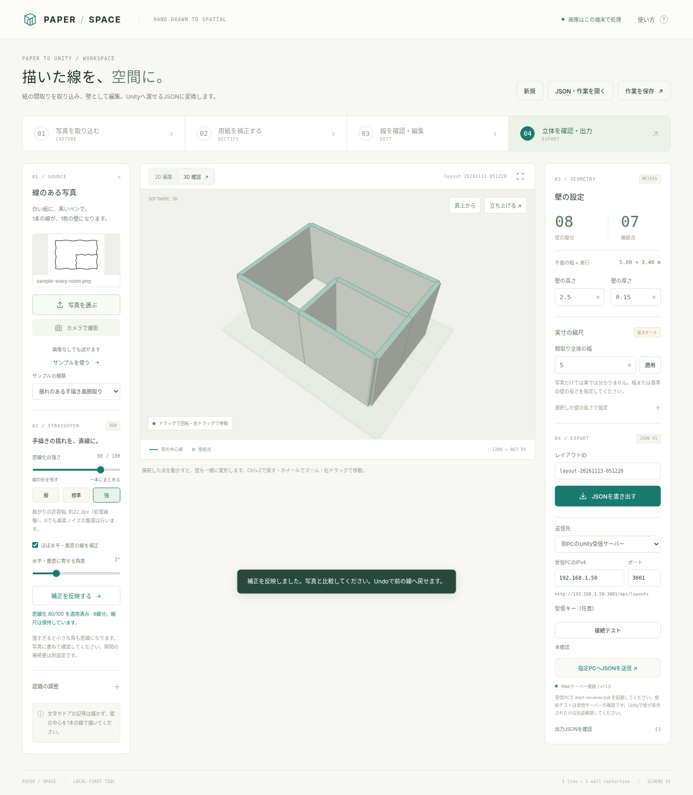

# PAPER / SPACE — v1.1

紙に黒いペンで描いた間取りを取り込み、壁の中心線を認識・編集して、Unity用のJSONに変換するWebアプリです。

**実装済みのWebアプリ、ローカルHTTPサーバー、サンプル画像、テストを含みます。Unityプロジェクト自体はこのパッケージには含めていません。**

## v1.1で追加したもの

**別PCへの送信先IP・ポート指定**、接続テスト、受信専用起動ファイル、**0〜100の直線化スライダー**、水平・垂直への補正角度、元の認識線からの再補正、Unityの受信・壁生成用C#サンプルを追加しました。

2台で使う場合は、操作PCで `start.bat`、Unity PCで `start-receiver.bat` を起動します。Web側にUnity PCのLANアドレスとポート（標準3001）を指定して送信します。詳しい導入手順・操作・API仕様は **`docs/UPDATE-1.1.md`** を読んでください。



## 最初に起動する

必要なのは **Node.js 20以上** と、Chrome / Edgeなどのブラウザです。開発時のNode.js動作確認環境は22.16.0です。

1. ZIPを展開します。ZIP内から直接起動せず、フォルダー全体を取り出してください。
2. Windowsでは `start.bat` をダブルクリックします。
3. 表示された `http://localhost:3000` をブラウザで開きます。
4. 最初は「サンプルを使う」を押してください。サンプル画像を実際に認識します。固定の認識結果を表示するモックではありません。

ターミナルからの起動もできます。

```powershell
cd "展開した場所\paper-to-walls"
node server/index.mjs
```

`npm start` でも同じです。**npm install、ビルド、APIキー、Python、UnityはWebアプリの起動に不要です。**

HTMLファイルのダブルクリックではなく、必ずHTTPサーバー経由で開いてください。ブラウザのES ModulesとWeb Workerを利用しています。終了はターミナルで `Ctrl+C`。

## スマートフォンから使う

PCとスマートフォンを同じ信頼できるWi-Fiへ接続し、起動時の `LAN:` に表示されたアドレスをスマートフォンのブラウザで開きます。

```text
例: http://192.168.1.20:3000
```

スマートフォンの `localhost` はスマートフォン自身を指すため、PCのアドレスに置き換えてください。Windows Firewallで確認された場合は、利用するプライベートネットワークに限ってNode.jsの通信を許可してください。ゲストWi-Fiの端末分離が有効だと接続できない場合があります。

「カメラで撮影」はファイル入力のカメラ機能を使います。ブラウザやOSによって写真選択が表示される場合は、通常のカメラアプリで撮影してから「写真を選ぶ」で読み込んでください。HEICを読み込めない端末ではJPEGに変換してください。ブラウザ内の連続撮影・ライブカメラ機能はありません。

## 操作の流れ

### 1. 写真を取り込む

白い紙に、壁の中心を黒いペンで1本線として描きます。JPEG・PNG・WebPを選択またはドロップします。ファイルは30MB以下、元画像は6400万画素以下を想定しています。端末内で長辺1600px以下に縮小します。

紙の四隅が入るように撮影し、机などの背景と紙の明るさが異なると補正候補を得やすくなります。文字、家具、ドアの開閉弧、窓の記号は描かないでください。これらを意味で識別して除外する機能はなく、線として認識されることがあります。二重線も原則として2本の壁になります。

### 2. 用紙を補正する

四隅の推定結果を必ず確認します。点の順番は **左上→右上→右下→左下** です。必要に応じてドラッグ、画像全体へのリセット、90°回転が使えます。

A4なら「A4・縦／横」を選びます。「四辺の長さから推定」は自由サイズ用ですが、写真だけでは用紙の本当の縦横比を確定できないため、強い斜め撮影では縦横の歪みが残る可能性があります。

「線を認識する」を押します。処理はWeb Worker内で行い、キャンセルできます。認識後は元画像に線と接続点が重なります。

### 3. 2Dで確認・修正する

| 操作 | 方法 |
|---|---|
| 接続点を移動 | 点をドラッグ。接続している複数の壁が追従します。 |
| 壁を移動 | 選択ツールで線の中央をドラッグ。共有する端点も一緒に移動します。 |
| 壁を追加 | 「追加」を選び、始点→終点をクリック／タップします。 |
| 壁を削除 | 「削除」で線をクリック、または選択してDeleteキー。 |
| 戻す／やり直す | ↶／↷、Ctrl+Z／Ctrl+Shift+Z。 |
| 拡大縮小 | ホイール、＋／−。タッチでは2本指。 |
| 表示を移動 | 「移動」でドラッグ、右ドラッグ、タッチでは2本指。 |
| 画像処理を確認 | 「認識した線」を二値化／中心線表示へ変更。 |

初期値では水平・垂直から3°以内の線だけを軸へ補正します。v1.1では直線化の強さ（0〜100）と軸補正の角度（0〜12°）を別々に調整できます。「補正を反映する」で元の認識線から再計算し、Undoで戻せます。斜め線をすべて直角に変える処理はしません。再認識は現在の手動編集を置き換えるため、確認が表示されます。

「認識の調整」では、明るさの閾値、最短線分、線分間の隙間、交点の補正距離、軸補正、処理解像度を変更できます。標準は長辺1200pxです。隙間の接続は初期値0pxですが、交点の補正は5pxまで許容するため、微小な隙間は確認してください。

### 4. 実寸と壁の寸法を設定する

写真から建物の実寸は分かりません。最初は認識した間取りの幅を5mとする**仮スケール**です。

- 「間取り全体の幅」に実際の幅を入れ、適用する。
- または、2D画面で基準の壁を選び、「選択した壁の長さで指定」を開いて、その長さを適用する。

どちらも縦横を同じ倍率で変換します。設定後の点の移動や壁追加で、勝手に全体が5mへ戻ることはありません。垂直な壁だけで幅がない場合は、基準の壁の長さを使います。

壁の高さは2.5m、厚さは0.15mが初期値です。高さは0.1〜20m、厚さは0.01〜2mです。

### 5. 3DとJSON

「3D確認」で回転・拡大・移動し、寸法と配置を確認します。「立ち上げる」で壁の高さが伸びる表示になります。WebGLが利用できない場合は、Canvasの簡易3D表示へ自動的に切り替わります。

「JSONを書き出す」でUnity用データを保存します。「指定PCへJSONを送信」は指定した別PCの受信サーバーに最新JSONを保存します。「このWebサーバーに保存」に切り替えると従来のローカル保存も可能です。**サーバーに接続している表示は、Unityが起動しているという意味ではありません。**

## 出力形式

前に作成した `sample_floorplan.json` と同じ形式です。既存サンプルは `web/samples/sample_floorplan.json` に同梱しています。

```json
{
  "schemaVersion": 1,
  "layoutId": "layout-001",
  "revision": 1,
  "units": "m",
  "wallHeight": 2.5,
  "wallThickness": 0.15,
  "walls": [
    { "id": "wall-001", "ax": 0, "ay": 0, "bx": 4, "by": 0 }
  ]
}
```

`ax, ay` と `bx, by` は壁の**中心線**の始点・終点です。JSONの平面Yは上向きです。Unityでは `(x, y) → (X, 0, Z)` とします。画像の上下反転とm単位への換算はWeb側で実行済みです。

原点は、補正後画像の左下の画素です。用紙の余白も座標に含まれるため、最初の壁の座標が必ず0になるわけではありません。JSONから読み込んだ場合は、そのJSONの座標原点を保持します。

同じ直線でもT字・十字の接続位置で分割されます。「壁の本数」は分割後の線分数です。厚みを持った壁の角は、Unity側でCubeを置いた場合と同様に重なります。接合部のブーリアン統合や建築用の精密な納まりは行いません。プレビューの床とグリッドは表示補助で、JSONには含みません。

ローカルファイルのrevisionはブラウザ内で増加します。API送信時はサーバーが別に採番します。ファイル運用とAPI運用を混在させる場合、番号の大小だけでなく取得元・layoutIdも扱ってください。

## Unityとつなぐ

### ファイル運用

書き出したJSONを既存Unityプロジェクトへ渡し、各線分にCubeを配置します。すでに仕様書どおりの受信・生成処理があれば、同じデータ構造をそのまま利用できます。

### HTTP運用

v1.1の別PC向けの具体的な設定は `docs/UPDATE-1.1.md` を参照してください。以下は従来からの受信APIです。

```text
GET  /api/health
POST /api/layouts
GET  /api/layouts/latest
```

Unityとサーバーを同じPCで動かす場合の取得先:

```text
http://127.0.0.1:3000/api/layouts/latest
```

Unity側で1秒に1回取得し、revisionが変わったときだけ差し替える運用を想定しています。初回未送信時は204、保存済みなら200です。ETag / If-None-Matchにも対応します。不正なJSONは422で拒否し、以前のデータを維持します。

最新データは `user-data/latest-layout.json` に保存します。サーバー再起動でも残ります。空のwalls配列は、明示的に壁をすべて消す指示です。Web画面では保存・送信前に確認します。

ポート変更例:

```powershell
$env:PORT = "3001"
node server/index.mjs
```

PC内だけで使う場合:

```powershell
$env:HOST = "127.0.0.1"
node server/index.mjs
```

## 作業の保存

「作業を保存」は、元画像、補正画像、四隅、編集した線、縮尺、補正設定、元の認識線を含む `.paper-space.json` を保存します。「JSON・作業を開く」から再開できます。**これは編集用で、Unityへ直接渡すデータではありません。**

自動保存はありません。元画像を含む作業ファイルは画像の内容がそのまま入るため、他人に渡す場合は内容を確認してください。通常の壁JSONには画像を含みません。既存の壁JSONも開いて編集できます。

## 実装構成

```text
web/
  index.html / styles.css / app.js
  recognizer.worker.js       画像処理の別スレッド実行
  lib/vision-core.js         射影補正・二値化・細線化・線追跡
  lib/straighten.js          手描きの揺れを強さ指定で直線化
  lib/geometry.js            交点・グラフ・単位換算・JSON検証
  lib/editor.js              2D編集・パン・ズーム・タッチ操作
  lib/preview.js             WebGL表示＋ソフトウェア3D
  lib/history.js             Undo / Redo
  samples/                   12種類の生成画像と元のサンプルJSON
server/
  app.mjs / index.mjs        静的配信・API・検証・永続保存
  forward.mjs               指定した別PCへの安全範囲を限定したHTTP中継
unity-bridge/
  PaperSpaceLayoutReceiver.cs 任意のUnity受信・Cube生成サンプル
scripts/
  generate_samples.py        テスト画像を再生成する任意の開発用スクリプト
  check.mjs                 JavaScript構文チェック
```

前の設計案にあったReact / OpenCV.js / Three.jsの代わりに、今回の実装はブラウザ標準のHTML / CSS / JavaScript / Canvas / WebGLと、Node.js標準APIで構成しています。製品コードに追加パッケージや外部CDNへの依存はありません。

実際の認識処理:

```text
四隅の確認 → 射影変換 → 輝度画像 → 適応二値化
→ 小さい連結成分の除去 → Zhang–Suen細線化
→ 中心線の端点・分岐点・閉ループを追跡
→ 折れ線の直線化 → 近接した同一直線の統合
→ L/T/十字交点で分割 → 編集用ノード・エッジ → m単位JSON
```

太いペンの左右の輪郭を2本の壁にしないため、輪郭ではなく中心線を追います。直線検出はHough変換ではなく、中心線グラフの追跡とRamer–Douglas–Peucker近似を使用します。閉ループは専用に追跡するので、端点がない四角形も対象です。

## テスト

```powershell
npm test
npm run check
```

v1.1の自動テスト56件が成功しています。既存図形の認識に加え、補正量による変化、元線の保持、隙間・斜め線・T字の保持、送信側・受信側の実HTTP通信、受信キー、送信失敗、タイムアウトなどを検証しています。

ブラウザとUnityの検証範囲・未確認事項は **`docs/TESTING.md`** を参照してください。任意の開発用ブラウザテストは `tests/browser_v11.py` です。Playwrightはテスト時だけ必要で、アプリの利用に追加パッケージは不要です。

## 制限と注意

用紙の自動検出は明るい領域から作る候補であり、紙を意味的に識別するAIではありません。白い机、強い影、反射、紙の折れ、厚い塗りつぶし、大きな曲線、非常に短い線、文字が多い画像では手動補正が必要です。自動認識だけで正解を保証するものではありません。

複雑な線図は1800線分候補、最終1000壁で制限します。座標は±10000mまでです。画像処理が45秒以内に完了しなければ停止し、解像度を下げる案内を出します。

ソフトウェア3Dは面の奥行き順で描画する簡易表示です。複雑に交差した面では表示順に誤差が出ることがあります。出力される壁の座標や寸法には影響しません。

サーバーは初期状態でLANアクセスを許可します。保存POSTに任意の受信キーは設定できますが、公開サービス向けの認証・暗号化ではないため、信頼できるローカルネットワーク内で利用してください。外部公開、ポート転送、公衆Wi-Fiでの運用は想定していません。

画像は通常サーバーにアップロードしません。APIへ送るのは壁のJSONだけです。

## 問題が起きたとき

- `node` が見つからない: Node.jsを導入し、ターミナルを開き直してください。
- ポート使用中: PORTを変えるか、先に起動したサーバーを終了してください。
- スマートフォンから開けない: 同じWi-Fi、PCのLANアドレス、プライベートネットワークのFirewall許可を確認します。
- 線が多すぎる: 用紙の範囲を絞り、影除去を強め、文字や背景を入れずに撮り直します。
- 壁が途切れる: 閾値を少し下げるか、最短線分を小さくして再認識します。最後は「追加」でつなげられます。
- 3Dが表示できない: 2DとJSON出力を先に利用し、ブラウザを変更するかGPU設定を確認してください。
- サーバー保存データが破損: 上書きを避けるため起動を停止します。`user-data/latest-layout.json` をバックアップして確認してください。


## Git管理対象

ソースコード、テスト、合成サンプル画像、JSONスキーマ、Unity受信スクリプト、説明用の画面画像を管理します。

`user-data/`・`receiver-data/` の保存済み間取り、`*.paper-space.json` の作業ファイル、`exports/`・`uploads/`、`.env` などの秘密設定、受信キー用のファイル、テストの生ログ・生成結果、依存関係・キャッシュ・IDE設定は `.gitignore` で除外します。独自の `DATA_DIR` を使用する場合は、リポジトリ外を指定するか、その保存先も `.gitignore` に追加してください。

任意の受信キーは環境変数 `RECEIVE_KEY` で設定し、ソースコードや起動バッチへ直接書き込まないでください。アプリが任意の `.env` ファイルを自動で読み込む機能はありません。`.gitignore` は秘密情報の検出機能ではないため、追跡対象ファイルに書き込んだ秘密情報を自動では防げません。

`.gitattributes` によりソースの改行を統一し、Windows起動用の `.bat` ファイルはチェックアウト時にCRLFにします。
